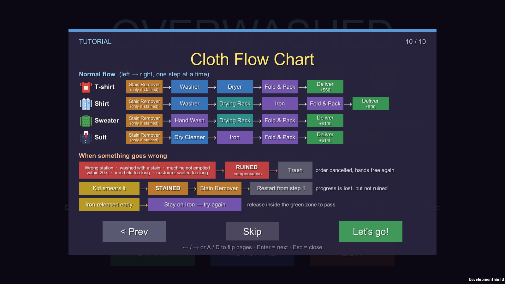
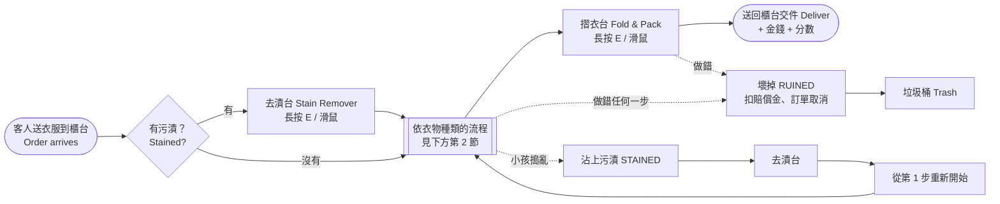
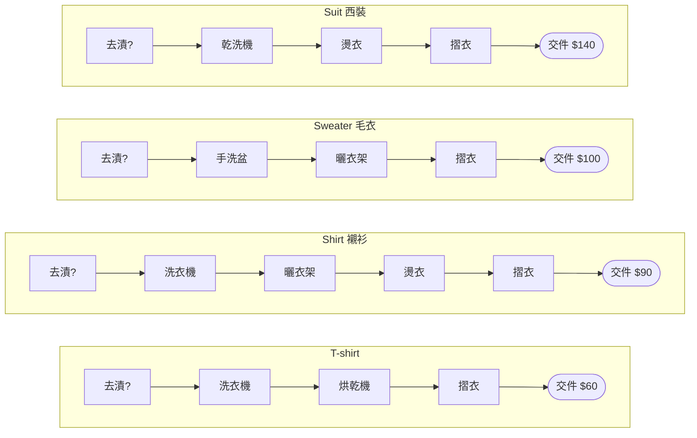
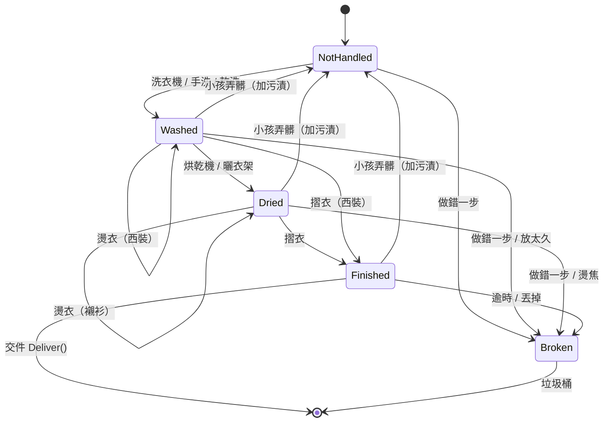

# 衣物處理流程圖（Cloth Flow）

這份文件說明每件衣服從「送到店裡」到「交回客人」的完整流程，以及過程中出事時會跑到哪一步。
遊戲內的新手教學最後一頁（Cloth Flow Chart）也是同一張圖，那一頁是直接讀取程式裡的流程畫出來的，改程式就會跟著變。

> 程式對應：流程定義在 `Assets/Scripts/Cloth/*.cs` 的 `procedure` 陣列；判斷邏輯在 `ClothBase.TryProcess()`。

---

## 1. 整體流程

## 2. 各衣物的正確流程

| 衣物 | 正確流程（有污漬時先去漬） | 交件金額 | 壞掉賠償 |
|---|---|---|---|
| 👕 T-shirt | 洗衣機 → 烘乾機 → 摺衣 | $60 | $40 |
| 👔 Shirt 襯衫 | 洗衣機 → 曬衣架 → 燙衣 → 摺衣 | $90 | $60 |
| 🧶 Sweater 毛衣 | 手洗盆（狂點） → 曬衣架 → 摺衣 | $100 | $80 |
| 🤵 Suit 西裝 | 乾洗機 → 燙衣 → 摺衣 | $140 | $120 |

## 3. 出事時會到哪一步

| 狀況 | 結果 | 接下來 |
|---|---|---|
| 放到錯的工作站（例：毛衣進烘乾機、西裝進洗衣機） | **壞掉**，扣賠償金，訂單取消 | 拿去垃圾桶丟掉 |
| 有污漬就直接洗／烘 | **壞掉**（污漬洗不掉了） | 垃圾桶 |
| 洗衣機／烘乾機／乾洗機做完後約 20 秒沒取出 | **壞掉**（發霉／過熱） | 垃圾桶 |
| 燙衣時按太久（進度條超過綠色區間） | **壞掉**（燙焦） | 垃圾桶 |
| 客人等太久（訂單倒數歸零） | **壞掉**，算「逾時」 | 垃圾桶 |
| 小孩把衣服弄髒（只會碰不在機器裡的衣服） | **沾上污漬**，進度歸零（沒壞） | 去漬台 → 從第 1 步重新開始 |
| 燙衣時太早放開 | 沒事，停在「燙衣」這一步 | 再燙一次，在綠色區間放開 |
| 衣服沒污漬卻放到去漬台 | 沒事，提示「沒有污漬」 | 拿起來繼續下一步 |
| 洗到一半把衣服從機器拿出來 | 沒事，該步驟沒有完成 | 放回去重新開始這一步 |

## 4. 程式裡的狀態（給寫程式的組員）

`ClothBase` 用組長原本的 `ClothState` 表示大階段，再用 `stepIndex` 記錄目前做到流程的第幾步：

- `Broken` 之後不能再回復（`ChangeState` 會直接 return），之後若要加「補救機制」可以從這裡改。
- 污漬 `IsStained` 是獨立的旗標：有污漬時下一步一定是去漬，否則做任何步驟都會壞掉。
